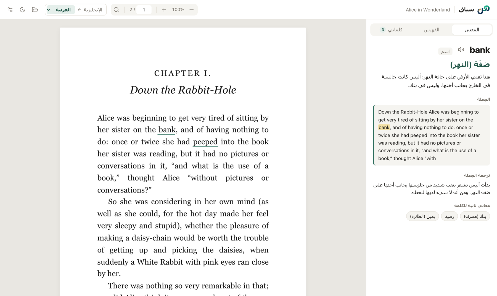

<div dir="rtl">

<p align="center">
  <picture>
    <source media="(prefers-color-scheme: dark)" srcset="src/logo-dark.svg">
    
  </picture>
</p>

<h1 align="center">سياق · Siyaq</h1>

<p align="center">
  <b>اقرأ الكتب بلغة أخرى دون أن تغادر الصفحة.</b><br>
  اضغط على أي كلمة في ملف PDF أو EPUB، ويظهر لك معناها <i>في هذه الجملة بالذات</i>.
</p>

<p align="center">
  <a href="https://github.com/SaadHASSON1/siyaq/releases/latest"></a>
  
  <a href="LICENSE"></a>
</p>

<p align="center">
  <a href="README.md">English</a> · <b>العربية</b>
</p>

<p align="center">
  
</p>

---

## لماذا سياق؟

عندما تقرأ كتاباً بلغة ما زلت تتعلّمها، تعني كل كلمة غير مفهومة أن تنسخها، وتنتقل إلى مترجم، ثم تعود. والأسوأ أن المترجم لا يرى الجملة، فيعطيك أحياناً معنى خاطئاً: كلمة *bank* بمعنى ضفّة النهر تصبح *bank* بمعنى البنك.

**سياق** يحلّ المشكلتين معاً: اضغط على الكلمة، فيظهر معناها بجانب الصفحة، مختاراً بحسب الجملة التي وردت فيها، مع شرح قصير للسبب.

## المميزات

**الفهم**
- 🎯 **المعنى حسب السياق**: الترجمة المناسبة *لهذه* الجملة، وسبب اختيارها، وترجمة الجملة كاملة، والمعاني الأخرى للكلمة
- 🗣️ **النطق**: استمع إلى لفظ أي كلمة
- ✍️ **العبارات الكاملة**: ظلّل حتى عشر كلمات، مثل *give up* أو *on the other hand*
- 🌍 **العربية والإنجليزية والتركية**: ترجم إلى أيٍّ منها، ولغة الكتاب تُكتشف تلقائياً

**القراءة**
- 📚 **ملفات PDF وEPUB**، تُفتح بنقرة مزدوجة كأي قارئ
- 🔍 **الكتب الممسوحة ضوئياً أيضاً**: الصفحات التي هي صور فقط تُقرأ على جهازك (OCR) باللغات الثلاث
- 📍 **يتذكّر أين توقفت** في كل كتاب
- 🧭 **فهرس جانبي، وبحث** (`⌘F` / `Ctrl+F`)، وروابط تعمل
- 🌙 **وضع داكن** يُعتّم الصفحات ويُبقي الصور بألوانها الحقيقية

**التذكّر**
- 📝 **كل كلمة تبحث عنها تُحفظ**، ويوضع تحتها خط أينما ظهرت مجدداً، والضغط عليها يعرض معناها المحفوظ فوراً
- 🃏 **بطاقات مراجعة** بالتكرار المتباعد، أو صدّرها إلى Anki

**الاحترام**
- 🔒 **كتبك لا تغادر جهازك أبداً.** فقط الجملة التي تسأل عنها تُرسل إلى الذكاء الاصطناعي.
- 💸 **مجاني ومفتوح المصدر.** بلا حساب، وبلا اشتراك، وبلا تتبّع.
- 🔄 **يحدّث نفسه** عند صدور نسخة جديدة

## التحميل

| النظام | الملف |
|---|---|
| **macOS** (Apple Silicon وIntel) | `Siyaq_x.y.z_universal.dmg` |
| **Windows** | `Siyaq_x.y.z_x64-setup.exe` |
| **Linux** | `.AppImage` أو `.deb` أو `.rpm` |

حمّلها من **[آخر إصدار](https://github.com/SaadHASSON1/siyaq/releases/latest)**.

> [!NOTE]
> سياق غير موقّع بشهادة مطوّر مدفوعة حتى الآن، لذلك يظهر تحذير عند أول تشغيل.
> **macOS:** انقر بالزر الأيمن على Siyaq ثم اختر **Open**. **Windows:** اختر **More info** ثم **Run anyway**.

## البداية

1. افتح سياق. ستأخذك خطوات قصيرة للحصول على **مفتاح Gemini مجاني** من [Google AI Studio](https://aistudio.google.com/apikey)، وتجربته.
2. افتح ملف PDF أو EPUB، أو اسحبه إلى النافذة.
3. اضغط على أي كلمة.

يختار سياق تلقائياً أسرع نماذج Gemini وأكبرها حصةً مجانية. ويمكنك أيضاً استخدام [Ollama](https://ollama.com) على حاسوبك، أو أي خدمة متوافقة مع OpenAI، أو Anthropic، من **الإعدادات**.

## الخصوصية

- الكتب تُفتح وتُقرأ على جهازك، ولا تُرفع إلى أي مكان.
- عند البحث عن كلمة، تُرسل الكلمة وجملتها فقط إلى مزوّد الذكاء الاصطناعي الذي اخترته.
- مفتاحك وكلماتك المحفوظة وإعداداتك تبقى على جهازك.
- الصفحات الممسوحة ضوئياً تُقرأ على جهازك دون حاجة إلى الإنترنت.

## البناء من المصدر

تحتاج إلى [Node.js](https://nodejs.org) و[Rust](https://rustup.rs).

```bash
git clone https://github.com/SaadHASSON1/siyaq.git
cd siyaq
npm install
npm run dev     # تشغيل التطبيق أثناء التطوير
npm run build   # بناء ملفات التثبيت لنظامك
```

الأمر `npm run web` يشغّل الواجهة وحدها على http://localhost:8765 للعمل السريع على التصميم.

كل دفعة إلى `main` تُبنى تلقائياً لـ macOS وWindows وLinux عبر GitHub Actions. ونشر وسم مثل `v0.5.0` يُنشئ مسودة إصدار فيها ملفات تثبيت وملفات تحديث موقّعة.

**مبني باستخدام** [Tauri](https://tauri.app) و[PDF.js](https://mozilla.github.io/pdf.js/) و[Tesseract.js](https://tesseract.projectnaptha.com) و[fflate](https://github.com/101arrowz/fflate).

## الخطة

- [x] PDF وEPUB، والصفحات الممسوحة ضوئياً، والوضع الداكن
- [x] العربية والإنجليزية والتركية، للواجهة وللترجمة
- [x] بطاقات المراجعة، والكلمات المحفوظة، والتحديث التلقائي
- [ ] Android للهواتف والأجهزة اللوحية، مع خيار *سياق* في قائمة تحديد النص في كل التطبيقات

## الرخصة

[MIT](LICENSE) © Saad HASSON

</div>
