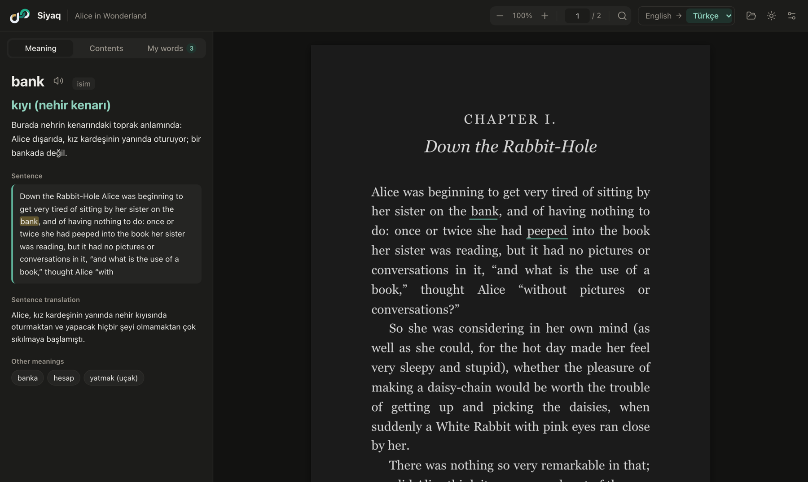

<p align="center">
  <picture>
    <source media="(prefers-color-scheme: dark)" srcset="docs/logo-full-dark.svg">
    
  </picture>
</p>

<h1 align="center">Siyaq · سياق</h1>

<p align="center">
  <b>Read books in another language without ever leaving the page.</b><br>
  Click any word in a PDF or EPUB and see what it means <i>in that sentence</i>.
</p>

<p align="center">
  <a href="https://github.com/SaadHASSON1/siyaq/releases/latest"></a>
  
  <a href="LICENSE"></a>
</p>

<p align="center">
  <a href="https://saadhasson1.github.io/siyaq/"><b>🌐 Website &amp; download</b></a>
</p>

<p align="center"><b>English</b> · <a href="README.ar.md">العربية</a></p>

<p align="center">
  
</p>

---

## Why Siyaq?

When you read a book in a language you're still learning, every unknown word means copying it, switching to a translator, and coming back. Worse, the translator doesn't see the sentence, so it often gives the wrong meaning: *bank* the river edge becomes *bank* the place for money.

**Siyaq** (Arabic for *context*) fixes both. Click a word and the meaning appears beside the page, chosen for the sentence it's in, with a short explanation of why.

## Features

**Understanding**
- 🎯 **Meaning in context**: the translation that fits *this* sentence, why, the whole sentence translated, and other meanings
- 🗣️ **Hear it**: pronunciation for any word
- ✍️ **Whole phrases**: select up to ten words, like *give up*
- 🌍 **Arabic, English and Turkish**: translate into any of them; the book's language is detected automatically

**Reading**
- 📚 **PDF and EPUB**, opened by double-clicking like any reader
- 🔍 **Scanned books too**: picture-only pages are read on your device (OCR), in all three languages
- 📍 **Picks up where you left off** in every book
- 🧭 **Contents sidebar, search** (`⌘F` / `Ctrl+F`) and working links
- 🌙 **Dark mode** that darkens pages but keeps pictures in their real colours

**Remembering**
- 📝 **Every word you look up is saved** and underlined wherever it appears again
- 🃏 **Flashcards** with spaced repetition, or export to Anki
- 🤖 **Works with Claude** and other MCP apps: summarise chapters or the whole book, search it, quiz yourself on your words

**Respect**
- 🔒 **Your books never leave your device.** Only the sentence you ask about is sent to the AI.
- 💸 **Free and open source.** No account, no subscription, no tracking.
- 🔄 **Updates itself** when a new version comes out

## Download

| Platform | File |
|---|---|
| **macOS** (Apple Silicon and Intel) | `Siyaq_x.y.z_universal.dmg` |
| **Windows** | `Siyaq_x.y.z_x64-setup.exe` |
| **Linux** | `Siyaq_x.y.z_amd64.AppImage` |

The easiest way: **[saadhasson1.github.io/siyaq](https://saadhasson1.github.io/siyaq/)** picks the right file for your device. Or open the **[latest release](https://github.com/SaadHASSON1/siyaq/releases/latest)** and download the one file for your device from the table at the top.

> [!NOTE]
> Siyaq isn't signed with a paid developer certificate yet, so the first launch shows a warning.
> **macOS:** right-click Siyaq → **Open**. **Windows:** **More info** → **Run anyway**.

## Getting started

1. Open Siyaq. A short setup walks you through getting a **free Gemini API key** from [Google AI Studio](https://aistudio.google.com/apikey) and tests it.
2. Open a PDF or EPUB, or drop it on the window.
3. Click any word.

You can also use [Ollama](https://ollama.com), any OpenAI-compatible service, or Anthropic, from **Settings**.

## Use it with Claude and other AI apps (MCP)

Siyaq can talk to AI apps that support [MCP](https://modelcontextprotocol.io), such as Claude Desktop. Then you can ask things like *"Summarise chapter 3"*, *"Where does the Cheshire Cat first appear?"*, *"Summarise the whole book"*, *"Explain the page I'm on"* or *"Quiz me on the words I saved this week"*, and add words to your flashcards from the chat.

1. In Siyaq, open **Settings** and turn on **Connect to AI apps**.
2. Click **Add to Claude Desktop**, then quit and reopen Claude. For another app, click **Copy setup** and paste it into that app's MCP settings.

Nothing is shared until you turn it on. The AI app reads the open book and your saved words only when you ask it something, and it uses your own account with that app. Word lookups inside Siyaq keep using your own API key, as before.

## Build from source

You need [Node.js](https://nodejs.org) and [Rust](https://rustup.rs).

```bash
git clone https://github.com/SaadHASSON1/siyaq.git
cd siyaq
npm install
npm run dev     # run the app while developing
npm run build   # build installers for your system
```

Pushing a tag such as `v0.5.0` builds signed installers and update files for every platform with GitHub Actions.

**Built with** [Tauri](https://tauri.app), [PDF.js](https://mozilla.github.io/pdf.js/), [Tesseract.js](https://tesseract.projectnaptha.com) and [fflate](https://github.com/101arrowz/fflate).

## Roadmap

- [x] PDF and EPUB, scanned pages, dark mode
- [x] Arabic, English and Turkish interface and translations
- [x] Flashcards, saved words, automatic updates
- [ ] Android, with *Siyaq* in the text-selection menu of every app

## License

[MIT](LICENSE) © Saad HASSON
